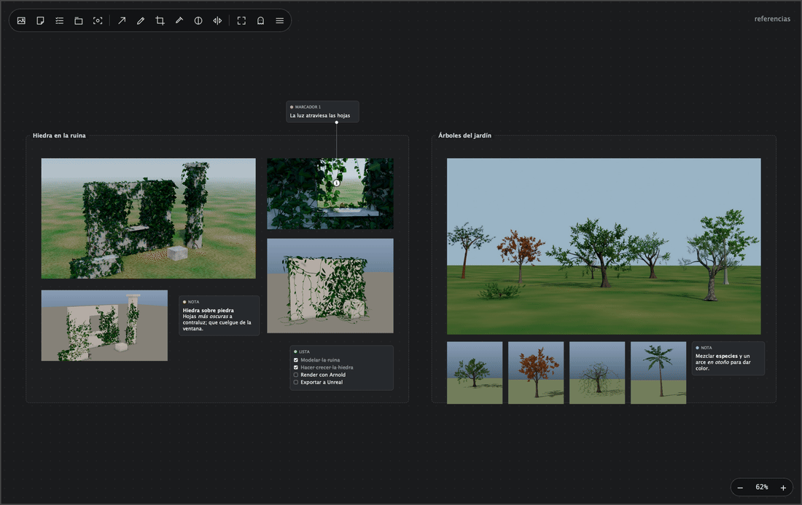
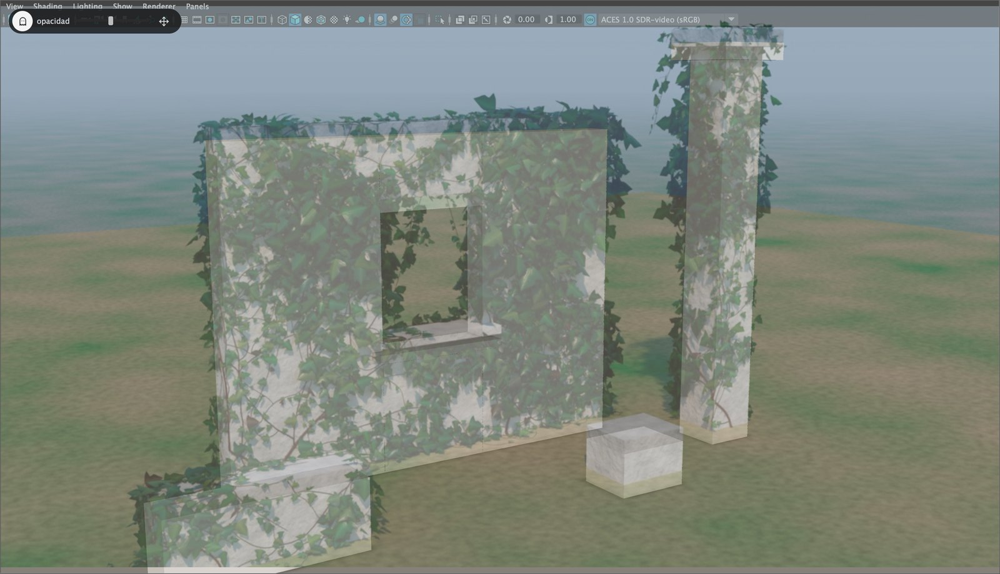

# Muro

Tablero de imágenes de referencia y notas dentro de Autodesk Maya (2026 y 2027, Mac y Windows).



Un lienzo infinito acoplable como cualquier panel de Maya. Los alumnos sueltan ahí sus referencias, las ordenan,
las anotan y las llevan al visor como planos de imagen a escala. El tablero se guarda dentro del proyecto de Maya,
así que la entrega lleva sus referencias.

## Instalar

1. Descarga o clona esta carpeta y déjala donde vaya a quedarse (por ejemplo `Documentos/maya/MURO`).
2. Abre Maya y arrastra `instalar.py` desde el Finder o el Explorador hasta el visor.
3. Aparece el menú **Muro** en la barra de Maya. Se carga solo cada vez que abres Maya.

Maya 2027 puede preguntar si confías en el plug-in de una carpeta nueva: pulsa *Allow*.
Para desinstalar, borra `muro.mod` de la carpeta `modules` de tus preferencias de Maya (la ruta sale en el
Script Editor al instalar).

## Qué hace

| | |
|---|---|
| **Lienzo infinito** | Ventana flotante o acoplada. Rueda o `Alt`+botón central para moverte, `Alt`+botón derecho para acercar, `F` y `A` para encuadrar. En el trackpad, dos dedos desplazan y pellizcar acerca. |
| **Traer imágenes** | Arrastrar desde el Finder, el Explorador o el navegador, pegar con `Ctrl/⌘+V`, abrir archivos o carpetas y capturar el visor de Maya. Las fotos enormes se ven con una miniatura y se carga el original solo al acercarse. |
| **Ordenar** | Mover, escalar (esquina), girar (punto de arriba, `Shift` de 15 en 15°), duplicar, al frente o al fondo, alinear, ordenar en rejilla y bloquear. |
| **Ver mejor** | Gris para estudiar valores, voltear en horizontal, recortar sin destruir la imagen y opacidad por imagen. |
| **Notas** | Texto con **negrita**, *cursiva* y listas; listas de tareas que se tachan con un clic; cinco tonos discretos. |
| **Marcadores** | Un número sobre un punto de la imagen unido a su nota por una línea fina. |
| **Marcos** | Agrupan referencias con un título; al moverlos se mueve lo de dentro. |
| **Flechas y lápiz** | Flechas que siguen a los elementos que unen y trazos a mano que se pegan a la imagen sobre la que se dibujan. |
| **Plano de imagen** | Marcas cabeza y pies, escribes cuánto mide y la referencia aparece en `front`, `side` o `top` a escala real, en una capa bloqueada. |
| **Cuentagotas** | Toma un color, lo guarda en la tira de muestras y lo pone en el color base del material seleccionado (Arnold, Standard Surface, OpenPBR, Lambert, Blinn…), en espacio lineal si la gestión de color está activa. |
| **Notas ligadas a objetos** | Una nota puede ir ligada a un objeto de la escena; clic en su cabecera y Maya lo selecciona aunque lo hayas renombrado. |
| **Modo fantasma** | El tablero se vuelve transparente encima del visor y deja pasar los clics a Maya, para modelar calcando. «Ajustar» permite colocar las referencias. |
| **Proyecto y escena** | Los tableros viven en `sourceimages/muro` del proyecto, con copia de las imágenes. La escena recuerda su tablero y lo abre al abrirla. |
| **Aula** | Exportar el tablero o un marco como PNG, guardar plantillas, y exportar o importar un tablero en `.zip` para repartirlo a los alumnos. |



Clic derecho abre un menú de seis puntos, el mismo de [Radial](https://github.com/adrianmantilla/radial), con
acciones distintas para imagen, nota, marco o fondo; «Más…» abre la lista completa.

## Atajos (solo con el ratón sobre el tablero)

| Atajo | Qué hace |
|---|---|
| Rueda · `Alt`+central · `Espacio`+arrastrar | Acercar · desplazar · desplazar |
| `Alt`+botón derecho | Acercar arrastrando |
| `F` · `A` | Encuadrar la selección · encuadrar todo |
| `Ctrl/⌘+V` · `Ctrl/⌘+C` | Pegar imagen o texto · copiar la imagen seleccionada |
| `N` · `L` | Nota nueva · lista de tareas nueva |
| `Ctrl+D` · `Ctrl+G` | Duplicar · enmarcar la selección |
| `G` · `H` | Gris · voltear |
| `W` · `P` · `C` · `I` | Flecha · lápiz · recortar · cuentagotas (`Esc` para salir) |
| `Ctrl+Z` · `Ctrl+Shift+Z` | Deshacer · rehacer (solo dentro del tablero) |
| `Supr` · flechas | Borrar · mover (con `Shift`, de 10 en 10) |
| Doble clic | Escribir en una nota o un título; en el fondo, nota nueva |

En el Editor de atajos de Maya, categoría *Custom Scripts › Muro*, puedes asignar teclas a `MuroAbrir`,
`MuroFantasma`, `MuroCapturarVisor` y `MuroNotaNueva`.

## Cómo se guarda

```
mi_proyecto/
  scenes/robot_v03.ma          ← recuerda su tablero (fileInfo "muro_tablero")
  sourceimages/muro/
    robot.muro/
      tablero.json             posiciones, notas, marcos, flechas…
      imagenes/                copias de las referencias
      miniaturas/              versiones pequeñas de las imágenes grandes
      planos/                  imágenes usadas en planos de imagen
```

Se guarda solo segundo y medio después de cada cambio, al cambiar de tablero y al guardar la escena.
Las plantillas están en `<preferencias de Maya>/muro/plantillas`.

## Para desarrollar

```
scripts/muro/
  modelo.py        datos del tablero, deshacer (sin Qt ni Maya)
  archivo.py       carpetas .muro, zip, plantillas (sin Qt ni Maya)
  escala.py        cuentas del plano de imagen y colores (sin Qt ni Maya)
  lienzo.py        vista, ratón, teclado, herramientas (Qt, sin Maya)
  items.py         imágenes, notas, marcos, flechas y trazos (Qt)
  ventana.py       barra flotante, menús, diálogos (Qt)
  fantasma.py      modo fantasma (Qt)
  menu_radial.py   menú de puntos de clic derecho (Qt)
  maya_servicios.py, interfaz_maya.py   todo lo que toca Maya
  i18n/es.json     textos de la interfaz
```

Pruebas sin Maya (con `pip install PySide6-Essentials` para las de Qt):

```
python -m unittest discover -s tests
```

Prueba con Maya sin interfaz (plugin, plano de imagen, materiales, escena):

```
mayapy herramientas/prueba_maya.py
```

Los textos están en `scripts/muro/i18n/es.json`. Para otro idioma, copia el archivo (por ejemplo `en.json`),
tradúcelo y arranca Maya con la variable de entorno `MURO_IDIOMA=en`.

## Licencia

MIT. Ver [LICENSE](LICENSE).
